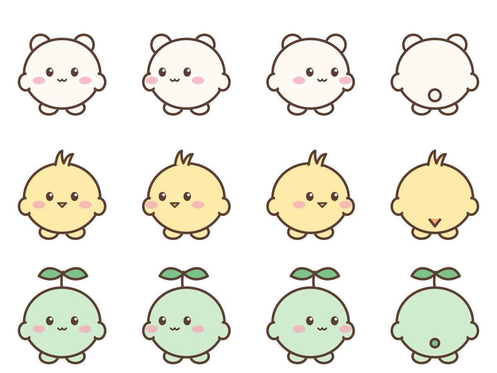

# 귀여운 오피스: 캐릭터 바꾸기 가이드

이 버전은 2D 오피스를 파스텔톤으로 바꾸고, 직원을 **직접 넣은 캐릭터 그림**으로 그려줘요.
그림을 안 넣으면 예시 캐릭터 3종(찹쌀떡, 병아리, 새싹)이 나와요.



## 1. 설치

```bash
git clone --depth 1 -b cute-office https://github.com/millo0o/whatsmyagentdoing ~/.claude/skills/myoffice
```

Node.js 18 이상이 필요해요. 설치한 뒤 Claude Code에서 `/myoffice`를 입력하거나 아래 명령으로 켜요.

```bash
node ~/.claude/skills/myoffice/bin/cli.js
```

## 2. 캐릭터 그림 준비

캐릭터 한 줄마다 **시트 2장**이 필요해요.

| 시트 | 4칸 (왼쪽부터) |
|---|---|
| 방향 시트 | 앞모습 · 왼쪽 보기 · 오른쪽 보기 · 뒷모습 |
| 걷기 시트 | 왼쪽으로 걷는 동작 4프레임 |

- 한 장에 캐릭터를 여러 줄 넣어도 돼요. 줄 수(`rows`)만 맞춰 적어주면 돼요.
- 방향 시트와 걷기 시트에서 **캐릭터 순서(줄)가 같아야** 해요.
- 배경은 **투명**하거나 **흰색**이면 돼요. 캐릭터끼리 겹치지 않게 간격을 두세요.
- 진한 외곽선이 있는 그림일수록 깔끔하게 잘려요.
- PNG, JPG, SVG 모두 돼요.

예시는 [assets/chars-example](assets/chars-example) 폴더에 있어요.

### 이미지 생성 AI로 만들 때 쓸 프롬프트 예시

> 귀엽고 동글동글한 캐릭터 3마리를 그려줘. 굵은 갈색 외곽선, 파스텔톤, 투명 배경.
> 4열 3행 그리드로, 한 행에 캐릭터 하나씩.
> 열 순서: 정면, 왼쪽을 보는 3/4 측면, 오른쪽을 보는 3/4 측면, 뒷모습.
> 캐릭터끼리 겹치지 않게 간격을 넉넉히 둬.

걷기 시트는 같은 캐릭터로 이렇게 요청해요.

> 같은 캐릭터들로, 왼쪽을 향해 걷는 동작 4프레임을 4열 3행 그리드로 그려줘.
> 발이 번갈아 나가게. 나머지 스타일은 똑같이.

**저작권 주의:** 직접 만들었거나 쓸 권리가 있는 그림만 넣으세요. 남의 캐릭터 그림은 개인적으로만 쓰고, 다시 배포하지 마세요.

## 3. 그림 넣기

1. `~/.claude/skills/myoffice/assets/chars/` 폴더를 만들고 시트 파일을 넣어요.
2. 같은 폴더에 `chars.json`을 만들어요.

```json
{
  "sheets": [
    { "dir": "my-directions.png", "walk": "my-walk.png", "rows": 3 }
  ]
}
```

시트 쌍이 여러 개면 `sheets`에 줄을 더 추가하면 돼요. 브라우저를 새로고침하면 바로 바뀌어요.
이 폴더는 `.gitignore`에 들어 있어서 git에 올라가지 않아요.

원래의 작은 사람 캐릭터로 돌아가려면 `chars.json`을 이렇게 바꿔요.

```json
{ "enabled": false }
```

## 바뀐 점 (원본과 비교)

- 2D 오피스 라이트 모드가 파스텔 배경, 물방울 벽지, 갈색 외곽선 스타일이에요.
- 직원이 캐릭터 그림으로 나오고, 걷기 애니메이션이 재생돼요.
- 세션마다 서로 다른 캐릭터가 배정돼요.
- 세션이 없는 캐릭터도 엑스트라로 사무실을 돌아다녀요(이름표 없음).
- 쉬는 세션이 7명 넘게 있어도 전부 돌아다녀요.

3D 모드와 다크 모드는 원본 그대로예요.
원본 프로젝트: [Charonyuu/whatsmyagentdoing](https://github.com/Charonyuu/whatsmyagentdoing) (MIT)
